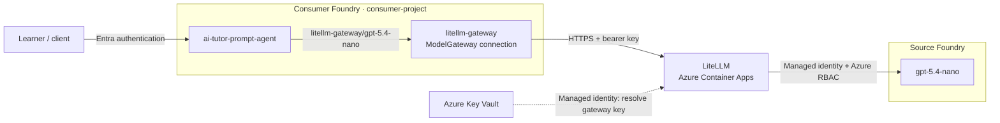

# LiteLLM on Azure Container Apps with Microsoft Foundry

An azd + Bicep sample deploying two independent Foundry accounts: a source
hosting `gpt-5.4-nano`, and a consumer running an AI tutor through LiteLLM.
The sample provisions no model capacity in the consumer account.

## Architecture



LiteLLM uses managed identity for upstream inference. The consumer connection
holds a gateway credential, not direct access to the source model.

## Prerequisites

- Azure CLI, Azure Developer CLI, and Bicep (`az bicep install`).
- Bash, OpenSSL, and Node.js 18+ for deployment hooks and tests.
- Subscription quota for `gpt-5.4-nano` with the `GlobalStandard` SKU.
- Permission to provision resources and create role assignments: Owner, or
  Contributor plus an appropriate Azure RBAC administrator role.

## Deploy

| Region | Location |
| --- | --- |
| **East US (default)** | `eastus` |
| UK South | `uksouth` |
| Sweden Central | `swedencentral` |

```bash
az login
azd auth login

# Substitute uksouth or swedencentral if needed.
azd env new litellm-demo --location eastus --subscription <subscription-id>
LITELLM_MASTER_KEY="sk-$(openssl rand -hex 32)" azd up
```

`azd up` provisions infrastructure and deploys the tutor through lifecycle hooks.
No Docker, container registry, Python packages, or Foundry azd extension is
required for the hook-based deployment.

Configuration:

- [main.parameters.json](infra/main.parameters.json) supplies configurable
  `tags`, currently `SecurityControl=Ignore` and `CostControl=Ignore`.
  Every Bicep module accepts the tags object, and all taggable resources receive
  it alongside `azd-env-name`. Use these governance values only where authorized;
  tags alone do not guarantee a policy exemption.
- [main.bicep](infra/main.bicep) orchestrates resource-group-scoped
  [modules](infra/modules). Regions are restricted to the three listed above.
  Use a new environment to change region after provisioning.
- The source model uses version `2026-03-17`, SKU `GlobalStandard`, and default
  capacity `10` (10,000 tokens/minute). Set `MODEL_CAPACITY` with `azd env set`
  before provisioning to change capacity. Availability and quota can change.
- **GlobalStandard does not guarantee inference stays in the selected region.**

## Update the tutor

Edit [agent.json](agents/ai-tutor-prompt-agent/agent.json), then run:

```bash
azd hooks run postdeploy
```

The tutor provides explanations, hints, worked examples, and practice questions.
It is a managed prompt agent with no external tools or persistent memory.
`ai-tutor-hosted-agent` is reserved for a future hosted implementation.

The JSON follows the standard prompt-agent layout: top-level `name`,
`description`, `kind`, `model`, and `instructions`. Each agent explicitly selects
its gateway model, currently `"model": "litellm-gateway/gpt-5.4-nano"`.
Changing this value selects a model; it does not provision one. The alias must
already be configured in LiteLLM and exposed by the Foundry connection.

The [deployment hook](scripts/deploy-prompt-agent.mjs) uses the signed-in Azure
CLI identity and the Bicep output `CONSUMER_FOUNDRY_PROJECT_ENDPOINT`.
It preserves the model from the agent file rather than overriding it with
`CONSUMER_MODEL_REFERENCE`. It maps the flat agent fields into the Foundry REST
request's `definition` object and calls the API (`api-version=v1`),
verifies persistence, and fails the azd command on errors. Unchanged definitions
reuse the latest version; changes create a new version.

[azure.yaml](azure.yaml) registers the same hook for `postprovision` and
`postdeploy`, so infrastructure and agent updates stay aligned. Running it twice
during `azd up` does not create duplicate versions. Agent deployment does not
read the LiteLLM key.

## Permissions and secrets

The deploying user receives explicit Azure RBAC assignments, independent of
Entra Global Administrator:

| Role | Scope |
| --- | --- |
| Contributor | Sample resource group |
| Key Vault Secrets Officer | Sample vault |
| Foundry User / Azure AI User | Both Foundry accounts |

Contributor does not permit role-assignment creation; provisioning RBAC still
requires appropriate administrator permissions. The template targets a human
deployer, not a CI service principal.

The gateway identity receives **Cognitive Services OpenAI User** on the source
account and **Key Vault Secrets User** on the vault. Both Foundry accounts disable
local API-key authentication.

`LITELLM_MASTER_KEY` is the shared LiteLLM bearer/admin credential. Bicep stores
it in an RBAC-protected, purge-protected Key Vault; ACA resolves a versionless
secret reference using managed identity. The Foundry connection stores a
separate secure copy, so rotation must update both.

For infrastructure updates, reuse the existing key rather than generating one:

```bash
vault="$(azd env get-value AZURE_KEY_VAULT_NAME)"
LITELLM_MASTER_KEY="$(az keyvault secret show --vault-name "$vault" \
  --name litellm-master-key --query value -o tsv)" azd provision
```

Never commit secrets or share `.azure/` contents. Using `azd env set` for the
master key persists a local copy; the process-scoped examples above avoid that.
Production consumers should use restricted gateway credentials, not its master key.

## Validate and operate

```bash
# Compile Bicep and run local contract/unit tests.
node --test tests/infra.test.mjs tests/agent.test.mjs

# Preview infrastructure changes; supply the existing master key as above.
azd provision --preview

# Delete the sample when finished.
azd down
```

In the consumer Foundry portal, inspect the connection under **Manage > Resource
details > Admin-connected models**, and select `ai-tutor-prompt-agent` to test
the tutor. Inference incurs model usage charges.

This is a public-network demonstration, not a production landing zone:

- LiteLLM is pinned to `v1.105.1`, with one always-on replica, 1 vCPU, 2 GiB,
  and no Postgres/Redis. There is no persistent spend tracking or high availability.
- Log Analytics retains logs for 30 days. Avoid logging sensitive prompts.
- RBAC propagation may delay initial requests. ACA capacity errors may require
  another supported region or a later retry; model quota does not guarantee ACA capacity.
- ACA checks versionless Key Vault references within 30 minutes. Mounted config
  changes may require restarting the active revision.
- Vault purge protection and Foundry soft deletion can reserve names after cleanup.
  Let deletion finish and use a new environment for clean retries; do not purge automatically.

## Current azd Foundry extension limitation

Foundry requires **`<connection-name>/<model-name>`** for a gateway-connected
prompt agent, here `litellm-gateway/gpt-5.4-nano`.

The tested `azure.ai.agents` extension (`1.0.0-beta.18`) rejects `/` in the
model field during native `azd deploy` validation:

```text
model deployment name "litellm-gateway/gpt-5.4-nano" is not valid
```

This prevents using the gateway reference directly in an `azure.ai.agent`
service. Quotes or escaping do not help: validation checks the parsed string.
Renaming the model or connection cannot remove Foundry's required separator.

**Workaround:** this sample uses azd hooks to deploy the agent through the
supported Foundry API, preserving the exact gateway reference. This is an
extension validation limitation, not a Foundry or LiteLLM limitation.

See [Foundry gateway-connected models](https://learn.microsoft.com/azure/foundry/agents/how-to/ai-gateway#create-a-prompt-agent-with-the-model-connection)
and [azd lifecycle hooks](https://learn.microsoft.com/azure/developer/azure-developer-cli/azd-extensibility).
