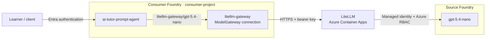
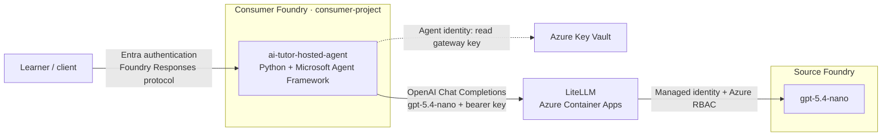

<div align="center">

# LiteLLM on Azure Container Apps with Microsoft Foundry

**Foundry agents use models through LiteLLM, and LiteLLM calls a model hosted in Foundry with its managed identity.**

[](infra)
[](azure.yaml)
[](litellm)

[**Quick start**](#quick-start) · [**Architecture**](#architecture) · [**The two tutors**](#the-two-tutors) · [**Documentation**](#documentation)

</div>

An azd + Bicep demo of **Microsoft Foundry and LiteLLM integration in both
directions**: Foundry agents consume models through LiteLLM, and LiteLLM calls a
model hosted in Foundry using managed identity.

Two independent AI tutors illustrate the agent-side integration:

- **Prompt agent:** Foundry routes model requests through a ModelGateway connection
  to LiteLLM.
- **Hosted agent:** Python code built with Microsoft Agent Framework runs in
  Foundry and calls LiteLLM's OpenAI-compatible API directly.

Both use the same `gpt-5.4-nano` model in a separate **source Foundry account**.
The **consumer Foundry account** hosts both agents but receives no model capacity
from this sample. Neither tutor calls the other or accesses the source model
directly.

## Why this sample

Many teams already run LiteLLM in front of their models, to give every application one OpenAI-compatible endpoint
with its own keys, routing and logs. This sample connects such a gateway to Microsoft Foundry in both directions:
Foundry agents, a prompt agent and a hosted agent, use their model through LiteLLM, and LiteLLM reaches a model hosted
in Foundry with its managed identity, without keys.

## Architecture

### Prompt agent: Foundry-managed gateway integration

The agent selects `litellm-gateway/gpt-5.4-nano`. Foundry resolves the connection
and authenticates to LiteLLM with its stored bearer credential; LiteLLM then
authenticates to the source Foundry model using managed identity and Azure RBAC.



### Hosted agent: direct OpenAI-compatible integration

The hosted tutor exposes the Foundry Responses protocol to clients. Its own
Python code calls LiteLLM Chat Completions with the alias `gpt-5.4-nano`, without
a ModelGateway connection or a call to the prompt tutor. Its agent identity reads
the gateway credential from Key Vault.



Both paths share the same LiteLLM deployment, whose identity also resolves its
gateway key from Key Vault. Both Foundry projects, the hosted tutor, and LiteLLM
use shared Application Insights; supported resource diagnostics go to its Log
Analytics workspace. See [Shared monitoring](docs/operate.md).

The diagrams above describe the **legacy default**. Entra modes replace the
client-to-gateway credential, not LiteLLM, either tutor, or the gateway's
managed-identity access to the source model. See [Incoming authentication](docs/incoming-authentication.md).

## What runs where

| Path | What it is |
|---|---|
| [agents/](agents) | The two tutors: `ai-tutor-prompt-agent` (its definition) and `ai-tutor-hosted-agent` (Python, Microsoft Agent Framework) |
| [litellm/](litellm) | LiteLLM's configuration and the gateway's Entra authentication |
| [infra/](infra) | Bicep: the two Foundry accounts, LiteLLM on Container Apps, Key Vault, monitoring, and the Entra registrations (`infra/entra`) |
| [scripts/](scripts) | azd hooks: the prompt agent's deployment, the Entra preparation, the prompt tutor's tools |
| [demo/](demo) | The optional MCP server and A2A agent behind the gateway ([demo/README.md](demo/README.md)) |
| [monitoring/](monitoring) | The OpenTelemetry collector's configuration |
| [tests/](tests) | Tests of the hooks, the infrastructure and the gateway |

## Quick start

### 1. Prerequisites

- Azure CLI, Azure Developer CLI 1.35+, and Bicep (`az bicep install`).
- Foundry agents azd extension (`azd extension install azure.ai.agents`).
- Bash, OpenSSL, and Node.js 18+ for deployment hooks and tests.
- Python 3.13 for local hosted-agent development (not required for remote builds).
- Subscription quota for `gpt-5.4-nano` with the `GlobalStandard` SKU.
- Permission to provision resources and create role assignments: Owner, or
  Contributor plus an appropriate Azure RBAC administrator role.
- Entra registration work is a **separate, explicitly approved** directory
  operation: the deploying identity needs application-management permissions
  (Microsoft Graph `Application.ReadWrite.All` or appropriate owned-application
  permissions and directory role). Creating service principals and granting
  consent require their corresponding tenant permissions; subscription Owner
  does not grant these. Normal resource provisioning does not provision directory
  objects or grant consent.
- Entra hosted mode needs a genuine Foundry Entra Agent ID and a runtime in
  which `DefaultAzureCredential` can obtain its gateway-audience token. A
  developer user's token or ordinary managed identity is not a substitute.
- Optional delegated operation additionally requires a trusted caller backend
  with sign-in/OBO support, approved human object IDs, approved agent application
  IDs, consent for `gateway.invoke`, and Agent ID/blueprint permissions for that
  flow. Agent-user impersonation has separate tenant prerequisites and is **not**
  implemented or accepted as human delegation here.

### 2. Deploy

| Region | Location |
| --- | --- |
| **East US (default)** | `eastus` |
| UK South | `uksouth` |
| Sweden Central | `swedencentral` |

```bash
az login
azd auth login

# Substitute uksouth or swedencentral if needed.
azd env new litellm-demo --location eastus --subscription <subscription-id>
LITELLM_MASTER_KEY="sk-$(openssl rand -hex 32)" azd up
```

`azd up` provisions infrastructure and deploys both tutors. The prompt agent uses
lifecycle hooks; the hosted agent uses native azd code deployment with a remote
Python build, followed by a Bicep RBAC hook. No Docker or container registry is
required.

## The two tutors

| Agent | Implementation | Model selection | Deploy/update |
| --- | --- | --- | --- |
| `ai-tutor-prompt-agent` | Foundry-managed prompt | `litellm-gateway/gpt-5.4-nano` through the ModelGateway connection | `azd hooks run postprovision` |
| `ai-tutor-hosted-agent` | Python + Microsoft Agent Framework | `gpt-5.4-nano` directly against LiteLLM `/v1` | `azd deploy ai-tutor-hosted-agent` |

Both provide explanations, hints, worked examples, and practice questions.
They are separate agents in `consumer-project`, with no external tools or
cross-session memory. Deploying either does not replace the other.

### Prompt tutor

Edit [agent.json](agents/ai-tutor-prompt-agent/agent.json), then run:

```bash
azd hooks run postprovision
```

The JSON follows the standard prompt-agent layout: top-level `name`,
`description`, `kind`, `model`, and `instructions`. The prompt agent explicitly selects
its gateway model, currently `"model": "litellm-gateway/gpt-5.4-nano"`.
Changing this value selects a model; it does not provision one. The alias must
already be configured in LiteLLM and exposed by the Foundry connection.

The [deployment hook](scripts/deploy-prompt-agent.mjs) uses the signed-in Azure
CLI identity and the Bicep output `CONSUMER_FOUNDRY_PROJECT_ENDPOINT`.
It preserves the model from the agent file rather than overriding it with
`CONSUMER_MODEL_REFERENCE`. It maps the flat agent fields into the Foundry REST
request's `definition` object and calls the API (`api-version=v1`),
verifies persistence, and fails the azd command on errors. Unchanged definitions
reuse the latest version; changes create a new version.

[azure.yaml](azure.yaml) registers the same hook for `postprovision` and
`postdeploy`, so infrastructure and agent updates stay aligned. Running it twice
during `azd up` does not create duplicate versions. Agent deployment does not
read the LiteLLM key.

### Hosted tutor

[main.py](agents/ai-tutor-hosted-agent/main.py) wraps an Agent Framework
`OpenAIChatCompletionClient` with Foundry's `ResponsesHostServer`. Clients invoke
it through the Foundry Responses protocol; its own model requests go to LiteLLM
Chat Completions, not to the prompt agent.

Edit [agent.json](agents/ai-tutor-hosted-agent/agent.json) to change its tutor
instructions or LiteLLM model alias, then run `azd deploy ai-tutor-hosted-agent`.
Its model is intentionally `gpt-5.4-nano`, without the connection prefix: direct
gateway requests use LiteLLM aliases, whereas the prompt agent uses Foundry's
connection-qualified name.

The hosted identity exists only after deployment, so a small service-level
`postdeploy` hook reads that identity and applies
[hosted-agent.bicep](infra/modules/hosted-agent.bicep) to grant **Key Vault Secrets
User** on just the gateway secret and **Monitoring Metrics Publisher** on the
shared Application Insights component. The code resolves the secret lazily on
model requests, rather than at server startup. No key is included in the code
package or hosted-agent environment.
The hook does not create or deploy the agent: packaging, remote build, versioning,
and publication use the standard Foundry azd extension.

For local development, create `.venv` in
[the hosted agent folder](agents/ai-tutor-hosted-agent), then run
`azd ai agent run ai-tutor-hosted-agent --no-client` from the project root.
The command installs the pinned Python dependencies and injects the selected azd
environment. Local calls use your signed-in Azure identity. Press **F5** in
VS Code to start the debugger and open Foundry Toolkit Agent Inspector.

## Permissions and secrets

The deploying user receives explicit Azure RBAC assignments, independent of
Entra Global Administrator:

| Role | Scope |
| --- | --- |
| Contributor | Sample resource group |
| Key Vault Secrets Officer | Sample vault |
| Foundry User / Azure AI User | Both Foundry accounts |
| Log Analytics Reader | Application Insights and its workspace |
| Privileged Monitoring Data Reader | Application Insights and its workspace (protected GenAI data) |

Contributor does not permit role-assignment creation; provisioning RBAC still
requires appropriate administrator permissions. The template targets a human
deployer, not a CI service principal.

The gateway identity receives **Cognitive Services OpenAI User** on the source
account and **Key Vault Secrets User** on the vault. Both Foundry accounts disable
local API-key authentication.

In legacy mode, `LITELLM_MASTER_KEY` is the shared LiteLLM bearer/admin credential. Bicep stores
it in an RBAC-protected, purge-protected Key Vault; ACA resolves a versionless
secret reference using managed identity. The Foundry connection stores a
separate secure copy, so rotation must update both.

For infrastructure updates, reuse the existing key rather than generating one:

```bash
vault="$(azd env get-value AZURE_KEY_VAULT_NAME)"
LITELLM_MASTER_KEY="$(az keyvault secret show --vault-name "$vault" \
  --name litellm-master-key --query value -o tsv)" azd provision
```

Never commit secrets or share `.azure/` contents. Using `azd env set` for the
master key persists a local copy; the process-scoped examples above avoid that.
Production consumers should use restricted gateway credentials, not its master key.

## Documentation

| Document | What it covers |
|---|---|
| [docs/incoming-authentication.md](docs/incoming-authentication.md) | How callers authenticate to LiteLLM: the legacy key, the Entra modes, hosted modes, delegation |
| [docs/entra-migration.md](docs/entra-migration.md) | The approval-gated move from the shared key to Entra authentication |
| [docs/tools.md](docs/tools.md) | The optional curriculum MCP server and quiz A2A agent through the gateway, and what was observed with prompt agents |
| [docs/operate.md](docs/operate.md) | Shared monitoring, local and live validation, operations |
| [docs/prompt-agent-deployment.md](docs/prompt-agent-deployment.md) | Why the prompt agent is deployed from an azd hook |
| [demo/README.md](demo/README.md) | The demo backends |

## Tech stack

Versions used in October 2026:

| Technology | Role | Version |
|---|---|---|
| [Microsoft Foundry](https://learn.microsoft.com/azure/ai-foundry/) | The prompt and hosted agents, and the source model | `gpt-5.4-nano` (GlobalStandard) |
| [LiteLLM](https://github.com/BerriAI/litellm) on Azure Container Apps | The gateway | v1.105.1 |
| [Microsoft Agent Framework](https://github.com/microsoft/agent-framework) | The hosted tutor (Python 3.13) | 1.22 |
| [Bicep](https://learn.microsoft.com/azure/azure-resource-manager/bicep/) and [azd](https://learn.microsoft.com/azure/developer/azure-developer-cli/) | The infrastructure and its deployment | azd 1.35+, `azure.ai.agents` 1.0.0-beta.18 |

## Versions and preview notes

As of October 2026:

- The hosted tutor uses `agent-framework-foundry-hosting` 1.0.0b261015, a pre-release package.
- The azd agents extension is `azure.ai.agents` 1.0.0-beta.18, a pre-release.

## Clean up

`azd down` removes what `azd up` provisioned. Key Vault purge protection and Foundry soft deletion can keep names
reserved after a clean-up: let the deletion finish, and use a new environment name for a clean retry.
