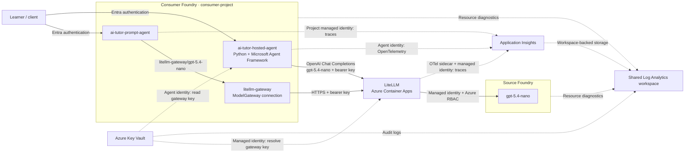

# LiteLLM on Azure Container Apps with Microsoft Foundry

An azd + Bicep sample deploying two independent Foundry accounts: a source
hosting `gpt-5.4-nano`, and a consumer running two independent AI tutors through
LiteLLM: a managed prompt agent and a Python hosted agent built with Microsoft
Agent Framework. Both demonstrate calling models behind the same gateway;
neither agent calls the other.
The sample provisions no model capacity in the consumer account.

## Architecture



LiteLLM uses managed identity for upstream inference. The prompt agent uses the
consumer's ModelGateway connection; the hosted agent calls LiteLLM's `/v1` API
directly. Neither has direct access to the source model.

## Prerequisites

- Azure CLI, Azure Developer CLI 1.35+, and Bicep (`az bicep install`).
- Foundry agents azd extension (`azd extension install azure.ai.agents`).
- Bash, OpenSSL, and Node.js 18+ for deployment hooks and tests.
- Python 3.13 for local hosted-agent development (not required for remote builds).
- Subscription quota for `gpt-5.4-nano` with the `GlobalStandard` SKU.
- Permission to provision resources and create role assignments: Owner, or
  Contributor plus an appropriate Azure RBAC administrator role.

## Deploy

| Region | Location |
| --- | --- |
| **East US (default)** | `eastus` |
| UK South | `uksouth` |
| Sweden Central | `swedencentral` |

```bash
az login
azd auth login

# Substitute uksouth or swedencentral if needed.
azd env new litellm-demo --location eastus --subscription <subscription-id>
LITELLM_MASTER_KEY="sk-$(openssl rand -hex 32)" azd up
```

`azd up` provisions infrastructure and deploys both tutors. The prompt agent uses
lifecycle hooks; the hosted agent uses native azd code deployment with a remote
Python build, followed by a Bicep RBAC hook. No Docker or container registry is
required.

Configuration:

- [main.parameters.json](infra/main.parameters.json) supplies configurable
  `tags`, currently `SecurityControl=Ignore` and `CostControl=Ignore`.
  Every Bicep module accepts the tags object, and all taggable resources receive
  it alongside `azd-env-name`. Use these governance values only where authorized;
  tags alone do not guarantee a policy exemption.
- [main.bicep](infra/main.bicep) orchestrates resource-group-scoped
  [modules](infra/modules). Regions are restricted to the three listed above.
  Use a new environment to change region after provisioning.
- The source model uses version `2026-03-17`, SKU `GlobalStandard`, and default
  capacity `10` (10,000 tokens/minute). Set `MODEL_CAPACITY` with `azd env set`
  before provisioning to change capacity. Availability and quota can change.
- **GlobalStandard does not guarantee inference stays in the selected region.**

## The two tutors

| Agent | Implementation | Model selection | Deploy/update |
| --- | --- | --- | --- |
| `ai-tutor-prompt-agent` | Foundry-managed prompt | `litellm-gateway/gpt-5.4-nano` through the ModelGateway connection | `azd hooks run postprovision` |
| `ai-tutor-hosted-agent` | Python + Microsoft Agent Framework | `gpt-5.4-nano` directly against LiteLLM `/v1` | `azd deploy ai-tutor-hosted-agent` |

Both provide explanations, hints, worked examples, and practice questions.
They are separate agents in `consumer-project`, with no external tools or
cross-session memory. Deploying either does not replace the other.

### Prompt tutor

Edit [agent.json](agents/ai-tutor-prompt-agent/agent.json), then run:

```bash
azd hooks run postprovision
```

The JSON follows the standard prompt-agent layout: top-level `name`,
`description`, `kind`, `model`, and `instructions`. The prompt agent explicitly selects
its gateway model, currently `"model": "litellm-gateway/gpt-5.4-nano"`.
Changing this value selects a model; it does not provision one. The alias must
already be configured in LiteLLM and exposed by the Foundry connection.

The [deployment hook](scripts/deploy-prompt-agent.mjs) uses the signed-in Azure
CLI identity and the Bicep output `CONSUMER_FOUNDRY_PROJECT_ENDPOINT`.
It preserves the model from the agent file rather than overriding it with
`CONSUMER_MODEL_REFERENCE`. It maps the flat agent fields into the Foundry REST
request's `definition` object and calls the API (`api-version=v1`),
verifies persistence, and fails the azd command on errors. Unchanged definitions
reuse the latest version; changes create a new version.

[azure.yaml](azure.yaml) registers the same hook for `postprovision` and
`postdeploy`, so infrastructure and agent updates stay aligned. Running it twice
during `azd up` does not create duplicate versions. Agent deployment does not
read the LiteLLM key.

### Hosted tutor

[main.py](agents/ai-tutor-hosted-agent/main.py) wraps an Agent Framework
`OpenAIChatCompletionClient` with Foundry's `ResponsesHostServer`. Clients invoke
it through the Foundry Responses protocol; its own model requests go to LiteLLM
Chat Completions, not to the prompt agent.

Edit [agent.json](agents/ai-tutor-hosted-agent/agent.json) to change its tutor
instructions or LiteLLM model alias, then run `azd deploy ai-tutor-hosted-agent`.
Its model is intentionally `gpt-5.4-nano`, without the connection prefix: direct
gateway requests use LiteLLM aliases, whereas the prompt agent uses Foundry's
connection-qualified name.

The hosted identity exists only after deployment, so a small service-level
`postdeploy` hook reads that identity and applies
[hosted-agent.bicep](infra/modules/hosted-agent.bicep) to grant **Key Vault Secrets
User** on just the gateway secret and **Monitoring Metrics Publisher** on the
shared Application Insights component. The code resolves the secret lazily on
model requests, rather than at server startup. No key is included in the code
package or hosted-agent environment.
The hook does not create or deploy the agent: packaging, remote build, versioning,
and publication use the standard Foundry azd extension.

For local development, create `.venv` in
[the hosted agent folder](agents/ai-tutor-hosted-agent), then run
`azd ai agent run ai-tutor-hosted-agent --no-client` from the project root.
The command installs the pinned Python dependencies and injects the selected azd
environment. Local calls use your signed-in Azure identity. Press **F5** in
VS Code to start the debugger and open Foundry Toolkit Agent Inspector.

## Permissions and secrets

The deploying user receives explicit Azure RBAC assignments, independent of
Entra Global Administrator:

| Role | Scope |
| --- | --- |
| Contributor | Sample resource group |
| Key Vault Secrets Officer | Sample vault |
| Foundry User / Azure AI User | Both Foundry accounts |
| Log Analytics Reader | Application Insights and its workspace |
| Privileged Monitoring Data Reader | Application Insights and its workspace (protected GenAI data) |

Contributor does not permit role-assignment creation; provisioning RBAC still
requires appropriate administrator permissions. The template targets a human
deployer, not a CI service principal.

The gateway identity receives **Cognitive Services OpenAI User** on the source
account and **Key Vault Secrets User** on the vault. Both Foundry accounts disable
local API-key authentication.

`LITELLM_MASTER_KEY` is the shared LiteLLM bearer/admin credential. Bicep stores
it in an RBAC-protected, purge-protected Key Vault; ACA resolves a versionless
secret reference using managed identity. The Foundry connection stores a
separate secure copy, so rotation must update both.

For infrastructure updates, reuse the existing key rather than generating one:

```bash
vault="$(azd env get-value AZURE_KEY_VAULT_NAME)"
LITELLM_MASTER_KEY="$(az keyvault secret show --vault-name "$vault" \
  --name litellm-master-key --query value -o tsv)" azd provision
```

Never commit secrets or share `.azure/` contents. Using `azd env set` for the
master key persists a local copy; the process-scoped examples above avoid that.
Production consumers should use restricted gateway credentials, not its master key.

## Shared monitoring

[monitoring.bicep](infra/modules/monitoring.bicep) creates one workspace-backed
Application Insights resource and its Log Analytics workspace. Local ingestion
authentication is disabled. Both Foundry projects connect to it with **Project
Managed Identity**, and each project identity receives **Monitoring Metrics
Publisher** on that component. Project-managed trace ingestion is a Foundry preview.

LiteLLM emits OpenTelemetry spans to a loopback-only collector sidecar, which
exports using the gateway managed identity and the same publisher role. Unlike
ACA's managed Application Insights exporter, this supports Entra-only ingestion.
The connection string identifies the component; it does not replace authentication.
Gateway prompt/response capture is disabled. Foundry traces can contain sensitive
GenAI data, which the deployer's explicit reader roles allow them to access.

The hosted tutor emits Agent Framework/OpenTelemetry traces to the same component
using its own identity, with message-content capture disabled. The prompt tutor
continues using Foundry's project-managed tracing.

Foundry accounts/projects, Key Vault, ACA, and the ACA environment send supported
resource logs and metrics to the same workspace. ACA uses Azure Monitor diagnostic
settings instead of workspace shared keys. Resource diagnostics are not Application
Insights traces; managed identities, role assignments, and secrets have no separate
diagnostic stream (vault operations are covered by vault audit logs).

azd exports `APPLICATIONINSIGHTS_NAME`, `APPLICATIONINSIGHTS_RESOURCE_ID`,
`APPLICATIONINSIGHTS_CONNECTION_STRING`, and `AZURE_LOG_ANALYTICS_WORKSPACE_ID`.
Use **Application Insights > Logs** or **Foundry > Agents > Traces** to inspect
telemetry. Resource logs are queried in the shared workspace. Ingestion may take
several minutes and incurs Azure Monitor charges.

## Validate and operate

```bash
# Compile Bicep and run local contract/unit tests.
node --test tests/infra.test.mjs tests/agent.test.mjs
node --test tests/hosted-agent.test.mjs
agents/ai-tutor-hosted-agent/.venv/bin/python -m unittest discover \
  -s agents/ai-tutor-hosted-agent -p 'test_*.py'

# Preview infrastructure changes; supply the existing master key as above.
azd provision --preview

# Delete the sample when finished.
azd down
```

In the consumer Foundry portal, inspect the connection under **Manage > Resource
details > Admin-connected models**, and select either `ai-tutor-prompt-agent` or
`ai-tutor-hosted-agent` to test the independent tutors. Inference and hosted-agent
compute incur usage charges.

This is a public-network demonstration, not a production landing zone:

- LiteLLM is pinned to `v1.105.1`, with one always-on replica, 1 vCPU, 2 GiB,
  and no Postgres/Redis. There is no persistent spend tracking or high availability.
- Its OpenTelemetry collector sidecar adds 0.25 vCPU and 0.5 GiB per replica.
- Log Analytics retains logs for 30 days. Avoid logging sensitive prompts.
- RBAC propagation may delay initial requests. ACA capacity errors may require
  another supported region or a later retry; model quota does not guarantee ACA capacity.
- ACA checks versionless Key Vault references within 30 minutes. Mounted config
  changes may require restarting the active revision.
- Vault purge protection and Foundry soft deletion can reserve names after cleanup.
  Let deletion finish and use a new environment for clean retries; do not purge automatically.

## Current azd Foundry extension limitation

Foundry requires **`<connection-name>/<model-name>`** for a gateway-connected
prompt agent, here `litellm-gateway/gpt-5.4-nano`.

The tested `azure.ai.agents` extension (`1.0.0-beta.18`) rejects `/` in the
model field during native `azd deploy` validation:

```text
model deployment name "litellm-gateway/gpt-5.4-nano" is not valid
```

This prevents using the gateway reference directly in a native prompt
`azure.ai.agent` service. Quotes or escaping do not help: validation checks the parsed string.
Renaming the model or connection cannot remove Foundry's required separator.

**Workaround:** this sample uses azd hooks to deploy the prompt agent through the
supported Foundry API, preserving the exact gateway reference. This is an
extension validation limitation, not a Foundry or LiteLLM limitation. It does not
affect the native hosted deployment: Python selects a LiteLLM alias at runtime
instead of declaring a Foundry model reference in the service manifest.

See [Foundry gateway-connected models](https://learn.microsoft.com/azure/foundry/agents/how-to/ai-gateway#create-a-prompt-agent-with-the-model-connection)
and [azd lifecycle hooks](https://learn.microsoft.com/azure/developer/azure-developer-cli/azd-extensibility).
