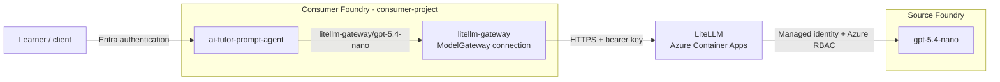
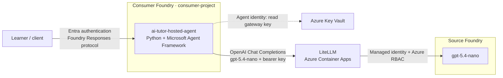

# LiteLLM on Azure Container Apps with Microsoft Foundry

An azd + Bicep demo of **Microsoft Foundry and LiteLLM integration in both
directions**: Foundry agents consume models through LiteLLM, and LiteLLM calls a
model hosted in Foundry using managed identity.

Two independent AI tutors illustrate the agent-side integration:

- **Prompt agent:** Foundry routes model requests through a ModelGateway connection
  to LiteLLM.
- **Hosted agent:** Python code built with Microsoft Agent Framework runs in
  Foundry and calls LiteLLM's OpenAI-compatible API directly.

Both use the same `gpt-5.4-nano` model in a separate **source Foundry account**.
The **consumer Foundry account** hosts both agents but receives no model capacity
from this sample. Neither tutor calls the other or accesses the source model
directly.

## Architecture

### Prompt agent: Foundry-managed gateway integration

The agent selects `litellm-gateway/gpt-5.4-nano`. Foundry resolves the connection
and authenticates to LiteLLM with its stored bearer credential; LiteLLM then
authenticates to the source Foundry model using managed identity and Azure RBAC.



### Hosted agent: direct OpenAI-compatible integration

The hosted tutor exposes the Foundry Responses protocol to clients. Its own
Python code calls LiteLLM Chat Completions with the alias `gpt-5.4-nano`, without
a ModelGateway connection or a call to the prompt tutor. Its agent identity reads
the gateway credential from Key Vault.



Both paths share the same LiteLLM deployment, whose identity also resolves its
gateway key from Key Vault. Both Foundry projects, the hosted tutor, and LiteLLM
use shared Application Insights; supported resource diagnostics go to its Log
Analytics workspace. See [Shared monitoring](#shared-monitoring).

The diagrams above describe the **legacy default**. Entra modes replace the
client-to-gateway credential, not LiteLLM, either tutor, or the gateway's
managed-identity access to the source model. See [Incoming authentication](#incoming-authentication).

## Requirements

- Azure CLI, Azure Developer CLI 1.35+, and Bicep (`az bicep install`).
- Foundry agents azd extension (`azd extension install azure.ai.agents`).
- Bash, OpenSSL, and Node.js 18+ for deployment hooks and tests.
- Python 3.13 for local hosted-agent development (not required for remote builds).
- Subscription quota for `gpt-5.4-nano` with the `GlobalStandard` SKU.
- Permission to provision resources and create role assignments: Owner, or
  Contributor plus an appropriate Azure RBAC administrator role.
- Entra registration work is a **separate, explicitly approved** directory
  operation: the deploying identity needs application-management permissions
  (Microsoft Graph `Application.ReadWrite.All` or appropriate owned-application
  permissions and directory role). Creating service principals and granting
  consent require their corresponding tenant permissions; subscription Owner
  does not grant these. Normal resource provisioning does not provision directory
  objects or grant consent.
- Entra hosted mode needs a genuine Foundry Entra Agent ID and a runtime in
  which `DefaultAzureCredential` can obtain its gateway-audience token. A
  developer user's token or ordinary managed identity is not a substitute.
- Optional delegated operation additionally requires a trusted caller backend
  with sign-in/OBO support, approved human object IDs, approved agent application
  IDs, consent for `gateway.invoke`, and Agent ID/blueprint permissions for that
  flow. Agent-user impersonation has separate tenant prerequisites and is **not**
  implemented or accepted as human delegation here.

## Deploy

| Region | Location |
| --- | --- |
| **East US (default)** | `eastus` |
| UK South | `uksouth` |
| Sweden Central | `swedencentral` |

```bash
az login
azd auth login

# Substitute uksouth or swedencentral if needed.
azd env new litellm-demo --location eastus --subscription <subscription-id>
LITELLM_MASTER_KEY="sk-$(openssl rand -hex 32)" azd up
```

`azd up` provisions infrastructure and deploys both tutors. The prompt agent uses
lifecycle hooks; the hosted agent uses native azd code deployment with a remote
Python build, followed by a Bicep RBAC hook. No Docker or container registry is
required.

## The two tutors

| Agent | Implementation | Model selection | Deploy/update |
| --- | --- | --- | --- |
| `ai-tutor-prompt-agent` | Foundry-managed prompt | `litellm-gateway/gpt-5.4-nano` through the ModelGateway connection | `azd hooks run postprovision` |
| `ai-tutor-hosted-agent` | Python + Microsoft Agent Framework | `gpt-5.4-nano` directly against LiteLLM `/v1` | `azd deploy ai-tutor-hosted-agent` |

Both provide explanations, hints, worked examples, and practice questions.
They are separate agents in `consumer-project`, with no external tools or
cross-session memory. Deploying either does not replace the other.

### Prompt tutor

Edit [agent.json](agents/ai-tutor-prompt-agent/agent.json), then run:

```bash
azd hooks run postprovision
```

The JSON follows the standard prompt-agent layout: top-level `name`,
`description`, `kind`, `model`, and `instructions`. The prompt agent explicitly selects
its gateway model, currently `"model": "litellm-gateway/gpt-5.4-nano"`.
Changing this value selects a model; it does not provision one. The alias must
already be configured in LiteLLM and exposed by the Foundry connection.

The [deployment hook](scripts/deploy-prompt-agent.mjs) uses the signed-in Azure
CLI identity and the Bicep output `CONSUMER_FOUNDRY_PROJECT_ENDPOINT`.
It preserves the model from the agent file rather than overriding it with
`CONSUMER_MODEL_REFERENCE`. It maps the flat agent fields into the Foundry REST
request's `definition` object and calls the API (`api-version=v1`),
verifies persistence, and fails the azd command on errors. Unchanged definitions
reuse the latest version; changes create a new version.

[azure.yaml](azure.yaml) registers the same hook for `postprovision` and
`postdeploy`, so infrastructure and agent updates stay aligned. Running it twice
during `azd up` does not create duplicate versions. Agent deployment does not
read the LiteLLM key.

### Hosted tutor

[main.py](agents/ai-tutor-hosted-agent/main.py) wraps an Agent Framework
`OpenAIChatCompletionClient` with Foundry's `ResponsesHostServer`. Clients invoke
it through the Foundry Responses protocol; its own model requests go to LiteLLM
Chat Completions, not to the prompt agent.

Edit [agent.json](agents/ai-tutor-hosted-agent/agent.json) to change its tutor
instructions or LiteLLM model alias, then run `azd deploy ai-tutor-hosted-agent`.
Its model is intentionally `gpt-5.4-nano`, without the connection prefix: direct
gateway requests use LiteLLM aliases, whereas the prompt agent uses Foundry's
connection-qualified name.

The hosted identity exists only after deployment, so a small service-level
`postdeploy` hook reads that identity and applies
[hosted-agent.bicep](infra/modules/hosted-agent.bicep) to grant **Key Vault Secrets
User** on just the gateway secret and **Monitoring Metrics Publisher** on the
shared Application Insights component. The code resolves the secret lazily on
model requests, rather than at server startup. No key is included in the code
package or hosted-agent environment.
The hook does not create or deploy the agent: packaging, remote build, versioning,
and publication use the standard Foundry azd extension.

For local development, create `.venv` in
[the hosted agent folder](agents/ai-tutor-hosted-agent), then run
`azd ai agent run ai-tutor-hosted-agent --no-client` from the project root.
The command installs the pinned Python dependencies and injects the selected azd
environment. Local calls use your signed-in Azure identity. Press **F5** in
VS Code to start the debugger and open Foundry Toolkit Agent Inspector.

## Permissions and secrets

The deploying user receives explicit Azure RBAC assignments, independent of
Entra Global Administrator:

| Role | Scope |
| --- | --- |
| Contributor | Sample resource group |
| Key Vault Secrets Officer | Sample vault |
| Foundry User / Azure AI User | Both Foundry accounts |
| Log Analytics Reader | Application Insights and its workspace |
| Privileged Monitoring Data Reader | Application Insights and its workspace (protected GenAI data) |

Contributor does not permit role-assignment creation; provisioning RBAC still
requires appropriate administrator permissions. The template targets a human
deployer, not a CI service principal.

The gateway identity receives **Cognitive Services OpenAI User** on the source
account and **Key Vault Secrets User** on the vault. Both Foundry accounts disable
local API-key authentication.

In legacy mode, `LITELLM_MASTER_KEY` is the shared LiteLLM bearer/admin credential. Bicep stores
it in an RBAC-protected, purge-protected Key Vault; ACA resolves a versionless
secret reference using managed identity. The Foundry connection stores a
separate secure copy, so rotation must update both.

For infrastructure updates, reuse the existing key rather than generating one:

```bash
vault="$(azd env get-value AZURE_KEY_VAULT_NAME)"
LITELLM_MASTER_KEY="$(az keyvault secret show --vault-name "$vault" \
  --name litellm-master-key --query value -o tsv)" azd provision
```

Never commit secrets or share `.azure/` contents. Using `azd env set` for the
master key persists a local copy; the process-scoped examples above avoid that.
Production consumers should use restricted gateway credentials, not its master key.

## Incoming authentication

Legacy deployments remain `api_key` unless explicitly migrated. Gateway and
hosted authentication modes are separate settings; changing one does not safely
migrate the other. No failed Entra request falls back to a key or app identity.

| Path / mode | Identity the gateway authorizes |
| --- | --- |
| Legacy prompt / hosted `api_key` | Shared gateway key; no authenticated human attribution |
| Prompt OAuth2 client credentials | Dedicated prompt-client application's service principal (`oid`) and application ID (`azp`), **not** the human or prompt agent's Agent ID |
| Hosted `entra` | Genuine hosted Entra Agent ID service principal and agent application ID |
| Hosted `entra_delegated` | Approved human `oid` plus approved agent actor `azp`, `gateway.invoke` scope, and AgentIdentity actor facet |

[entra_auth.py](litellm/entra_auth.py) uses LiteLLM's documented OSS
[`custom_auth`](https://docs.litellm.ai/docs/proxy/custom_auth) hook, with PyJWT
signature validation. Built-in `enable_jwt_auth` is Enterprise-gated in
`v1.105.1` and is not enabled. Neither `custom_auth_settings.mode: auto` nor
JWT-to-virtual-key mapping is used. No database, Enterprise license, native
budget, or rate-limit enforcement is implied by the returned auth object.
Model-access enforcement is explicit, rather than relying on `models=[...]`.

The policy accepts only RS256, the configured tenant's exact v2 issuer, and
the gateway application **client ID GUID as audience**. The requested scope is
`api://<gateway-client-id>/.default`; it is not the token's `aud`. Signature,
expiry, not-before, issued-at and required identity claims are checked.
Signing keys come only from that tenant's configured Microsoft Entra v2
JWKS endpoint, never token-supplied URLs. Fetches have 2s connect/5s network
timeouts, a 5-minute cache, and a 30s unknown-key refresh cooldown. Key-service
failures fail closed; a newly rotated key can require waiting out that cooldown.

App-only authorization is an exact allowlist of service-principal/application-ID
pairs (`ENTRA_APP_PRINCIPALS`). A subject is not classified as human merely
because it has `oid`: app requests require `idtyp=app`; delegated requests require
an approved human, approved actor, delegated scope and `xms_act_fct` AgentIdentity
facet `11`. Agent subjects/users (`xms_sub_fct` `11`/`13`) cannot impersonate an
approved human. See Microsoft's [Agent ID claims reference](https://learn.microsoft.com/entra/agent-id/agent-token-claims).

In Entra mode only POST `/chat/completions`, `/v1/chat/completions`, `/responses`,
and `/v1/responses` with alias `gpt-5.4-nano` are exposed for inference.
Only exact GET `/health/liveliness` and `/health/readiness` remain anonymous
for the existing ACA probes. Management, UI, other health routes, query strings,
provider overrides and unrecognized inference options are denied. Request bodies
are capped at 4 MiB. Supported OpenAI generation settings pass through; caller
`user`/`metadata` fields are discarded, not used as identity or trusted telemetry.

The Entra launcher wraps LiteLLM in [gateway_app.py](litellm/gateway_app.py) to
remove bearer/alternate credential headers and untrusted tracing baggage
**before** LiteLLM sees request headers. The custom-auth hook still performs
authentication and authorization, returning only nonsecret validated identity.
Raw tokens are never returned as `api_key`/`token` or usage metadata.
Spend persistence and message capture are disabled. This is not a multi-tenant
governance service; it supplies no billing or per-user rate-limit guarantees.

### Hosted modes and playground

[main.py](agents/ai-tutor-hosted-agent/main.py) supports explicit `api_key`,
`entra`, and `entra_delegated` modes. Only `api_key` constructs a Key Vault
client. `entra` obtains a gateway token with `DefaultAzureCredential`, then
checks that its subject/client match the configured genuine Agent ID and agent
facet before sending it. This is an identity-consistency guard, not a replacement
for gateway signature validation.

Credentials are applied with HTTPX request-local auth, not OpenAI's mutable
shared `api_key` provider state. Redirects and automatic inference retries are
disabled; owned async clients close on server shutdown, including cancellation.
The public `ResponsesHostServer.prepare_options(request, options)` signature was
verified against hosting SDK `1.0.0b261015`. The hook removes **only** Responses
`include`, logging a fixed unsupported-projections warning without the values.
Other options are preserved. Both streaming and non-streaming Responses requests
are tested against their actual downstream Chat Completions bodies.

### Delegation is opt-in, not playground OBO

A trusted caller backend must perform sign-in/consent and the Entra Agent ID
OBO exchange externally. It authenticates to Foundry normally and supplies the
**gateway-audience** user-via-agent token separately in
`x-client-litellm-authorization: Bearer <token>`. Never expose an untrusted
forwarding endpoint that accepts arbitrary users' credentials.

The hosted middleware removes this header before hosting-adapter metadata
handling, holds its token in request-local context, and clears/deactivates it
on completion or cancellation. Foreground requests only are supported;
background inference is rejected. Follow-up requests must provide their own
token; there is no identity fallback or stored-token resumption. HTTP telemetry
credential headers are sanitized and message capture is disabled.

The default policy supports both approved app-only clients and approved
delegation. `ENTRA_DELEGATED_ONLY=true` instead denies app-only on **all** gateway
inference routes, including prompt OAuth2; it does not invent a separate URL
prefix. Use a separately configured gateway for a delegated-only interface
alongside an app-only prompt tutor. The real-proxy tests prove app-only denial
with this policy. CLI preauthorization does not bypass actor/human policy.
This repository does not create a sign-in app, execute OBO, grant live consent,
or make the Foundry playground automatically forward a delegated token.

## Approval-gated Entra migration

Nothing below is run automatically by this change. Approve directory changes,
credential operations, resource updates, tutor deployments and permission
revocation separately. Keep existing identities, registration IDs and the existing
master key. Plan a coordinated cutover: one gateway authentication mode is active
at a time; Entra mode does not continue accepting legacy keys.

1. **Register or adopt directory identities separately.** Use
   [infra/entra/main.bicep](infra/entra/main.bicep), not ordinary `azd provision`.
   Its Microsoft Graph extension is pinned to GA `microsoftgraph/v1.0:1.0.0`.
   Keep a stable `registrationKey` for repeat deployments. For adoption, prepare
   a nonsecret `registration.json` containing `tenantId`, `registrationKey`,
   `gateway` and `prompt` identity objects, each with `objectId`, `clientId` and
   `principalId`; include the existing `gatewayScopeId`. Optional
   `preauthorizeAzureCli` is for controlled testing, not an authorization bypass.
   Run the approval-gated preparation script first:

   ```bash
   node scripts/prepare-entra-registration.mjs --config registration.json --approve
   ```

   Preparation validates IDs, sets a missing immutable `uniqueName`, and
   merges only the required API/scope/optional-claim settings, preserving
   unrelated manifest settings, scope IDs and credentials. Adopted applications
   are read with Graph `existing` declarations rather than redeclared manifests.
   Repeat deployments must retain the same registration key/unique names;
   service principals resolve by unchanged application IDs.

   Deploy the separate Graph template to an existing approved resource group:

   ```bash
   az deployment group create --resource-group "$AZURE_RESOURCE_GROUP" \
     --name entra-registration --template-file infra/entra/main.bicep \
     --parameters registrationKey="$REGISTRATION_KEY" \
       existingGatewayObjectId="$GATEWAY_OBJECT_ID" \
       existingPromptObjectId="$PROMPT_OBJECT_ID" \
       gatewayScopeId="$GATEWAY_SCOPE_ID"
   ```

   For **new** registrations omit the three adoption parameters. Microsoft
   Graph reads can lag a just-created application, so the first deployment can
   fail with `Request_ResourceNotFound` in the `gateway-api-identifier` step:
   wait briefly and re-run the identical command, which is idempotent. Retain the
   nonsecret application, service-principal and scope outputs. Do not create
   passwords in Bicep, replace registrations, reset credentials, or infer object
   IDs from display names. Consent and genuine hosted Agent ID permissions
   remain separate approval-gated tenant operations.

2. **Configure nonsecret policy.** Entra mode runs on the same pinned stock
   LiteLLM image: its `proxy` extra already provides PyJWT, `cryptography` and
   `httpx`, and the launcher imports them at startup, failing closed if absent.
   No custom image or runtime package installation is needed. Set `ENTRA_TENANT_ID`,
   `ENTRA_GATEWAY_CLIENT_ID`, `ENTRA_AGENT_CLIENT_ID`,
   `ENTRA_AGENT_PRINCIPAL_ID`, and `ENTRA_PROMPT_CLIENT_ID` to the preserved,
   verified identifiers. `ENTRA_APP_PRINCIPALS` is a JSON array of approved
   `{"oid":"<service-principal-id>","azp":"<application-client-id>"}` pairs,
   including the dedicated prompt client and hosted Agent ID.
   `ENTRA_DELEGATED_USERS` and `ENTRA_DELEGATED_ACTORS` are JSON arrays of GUIDs;
   leave them empty unless delegation and consent have been approved.
   Only these nonsecret settings belong in azd state.

3. **Preview, approve and apply the resource cutover.** Use
   `GATEWAY_AUTH_MODE=entra`, `HOSTED_AUTH_MODE=entra` (or explicitly
   `entra_delegated`), and `PROMPT_AUTH_MODE=oauth2`. Keep
   `ENTRA_DELEGATED_ONLY=false`: the shared deployment requires prompt app-only
   access and rejects a global delegated-only policy. `ENTRA_GATEWAY_SCOPE` is
   derived as `api://<gateway-client-id>/.default`.
   Run `azd provision --preview` with the existing process-scoped master key,
   inspect the changes, then provision only after approval. Ordinary resource
   deployment and native hosted-agent hooks remain resource/agent operations,
   not implicit directory provisioning.

4. **Explicitly configure prompt OAuth credentials and the connection.**
   Prepare a nonsecret `prompt-oauth.json` with `tenantId`, `gateway` and `prompt`
   identity objects as above, plus `subscriptionId`, `resourceGroup`,
   `consumerFoundryName`, `consumerProjectName`, `vaultName`, `secretName`,
   `litellmEndpoint`, and `modelDeploymentName` (`gpt-5.4-nano`).
   Then approve and run:

   ```bash
   node scripts/configure-prompt-oauth.mjs --config prompt-oauth.json --approve
   ```

   [configure-prompt-oauth.mjs](scripts/configure-prompt-oauth.mjs) verifies
   application/service-principal identifiers before credential operations,
   creates or reuses the dedicated application's credential in Key Vault,
   and configures ModelGateway **OAuth2 client credentials**, not
   `ProjectManagedIdentity`, using Graph, Key Vault and ARM calls. Ordinary
   provisioning skips the legacy connection module in `oauth2` mode, so it
   does not overwrite the configured OAuth connection.
   No secret belongs in source, deployment outputs,
   logs, command-line parameters, or azd state.
   Expired or mismatched credentials cause an error; they are never silently
   replaced. To rotate deliberately, repeat with `--approve --rotate`.
   Reapply/verify the connection before retiring an old credential; do not
   remove credentials still used by a legacy deployment.

5. **Approve tutor deployment and Azure acceptance testing.** Deploy the
   independent tutors with the updated settings and existing identities.
   Verify the prompt application and the genuine hosted Agent ID independently,
   both health probes, supported streaming/non-streaming playground options,
   source-model managed-identity access, and negative authorization cases.
   Verify delegation only with the trusted OBO backend and consent in place.
   Never retry a denied human request using app credentials.

6. **Revoke old hosted secret access only after verification and approval.**
   Entra hosted deployments omit new secret-read grants but retain the
   telemetry publisher grant. Incremental Bicep omission does **not** revoke
   existing assignments. Prepare a nonsecret `revoke.json` with `tenantId`,
   `subscriptionId`, `resourceGroup`, `vaultName`, `agentPrincipalId`,
   the exact `assignmentId`, the chosen `hostedAuthMode`,
   `legacyHostedEnabled:false`, and `entraVerified:true`. Then run:

   ```bash
   node scripts/revoke-hosted-key-access.mjs --config revoke.json --approve
   ```

   The scoped migration script validates the assignment before removing it.
   Do not remove a grant or credential required by an explicitly enabled legacy
   deployment. Stop sharing the master key as an inference credential after
   migration; the gateway may still need its own backend vault reference.

## Shared monitoring

[monitoring.bicep](infra/modules/monitoring.bicep) creates one workspace-backed
Application Insights resource and its Log Analytics workspace. Local ingestion
authentication is disabled. Both Foundry projects connect to it with **Project
Managed Identity**, and each project identity receives **Monitoring Metrics
Publisher** and **Monitoring Reader** on that component. The App Insights
connection waits for both component-scoped assignments; the reader is the
**project's** identity, not the account identity. Project-managed trace ingestion
is a Foundry preview.

LiteLLM emits OpenTelemetry spans to a loopback-only collector sidecar, which
exports using the gateway managed identity and the same publisher role. Unlike
ACA's managed Application Insights exporter, this supports Entra-only ingestion.
The connection string identifies the component; it does not replace authentication.
Gateway prompt/response capture is disabled. Foundry traces can contain sensitive
GenAI data, which the deployer's explicit reader roles allow them to access.

The hosted tutor emits Agent Framework/OpenTelemetry traces to the same component
using its own identity, with message-content capture disabled. The prompt tutor
continues using Foundry's project-managed tracing.

Foundry accounts/projects, Key Vault, ACA, and the ACA environment send supported
resource logs and metrics to the same workspace. ACA uses Azure Monitor diagnostic
settings instead of workspace shared keys. Resource diagnostics are not Application
Insights traces; managed identities, role assignments, and secrets have no separate
diagnostic stream (vault operations are covered by vault audit logs).

azd exports `APPLICATIONINSIGHTS_NAME`, `APPLICATIONINSIGHTS_RESOURCE_ID`,
`APPLICATIONINSIGHTS_CONNECTION_STRING`, and `AZURE_LOG_ANALYTICS_WORKSPACE_ID`.
Use **Application Insights > Logs** or **Foundry > Agents > Traces** to inspect
telemetry. Resource logs are queried in the shared workspace. Ingestion may take
several minutes and incurs Azure Monitor charges.

## Validate and operate

```bash
# Compile Bicep and run local contract/unit tests (no resource deployment).
node --test tests/*.test.mjs
agents/ai-tutor-hosted-agent/.venv/bin/python -m unittest discover \
  -s agents/ai-tutor-hosted-agent -p 'test_*.py'

# Separate local environment for the pinned real LiteLLM tests.
python3.13 -m venv .venv
.venv/bin/python -m pip install -r tests/requirements.gateway.txt
.venv/bin/python -m unittest discover -s tests -p 'test_*.py'
```

Local tests use generated RSA tokens, mocked JWKS and inference services, the
real LiteLLM `1.105.1` HTTP/auth stack (including its file-based hook loader), and
the pinned hosting SDK/OpenAI HTTP transport. They verify denial without
inference/fallback, strict claims/routes/models, health probes, simulated signing
key rotation/outage, legacy behavior, `include` handling, concurrent user
isolation, cancellation, cleanup and token redaction. Prisma's Python package
is a **test dependency** for LiteLLM's error classifier; no database is started.

### Live verification (one test environment)

Beyond the local tests, the following were exercised against the live `uksouth`
sample environment. Nothing else here is claimed as Azure-verified.

| Verified live | Result |
| --- | --- |
| Monitoring Reader + Publisher on the App Insights component for both project identities | Present, component-scoped; connections intact |
| Legacy `api_key` gateway and hosted tutor after provisioning | 401 without key, 200 with key; tutor works |
| Hosted Responses with `include` (streaming, non-streaming, empty) | 200 |
| Graph registration (new apps, v2 tokens, `gateway.invoke`, optional claims) | Created; repeat deployment leaves IDs unchanged |
| Entra gateway on the stock image | Healthy; probes 200; all other routes 403; master key 401; no fallback |
| Real prompt-client token claims | `aud`=gateway client-ID GUID, `ver` 2.0, `idtyp` app, expected `azp`/`oid` |
| Policy: valid/streaming inference; other model, `api_base`, `/key/*`, `/v1/models`, wrong-audience token | 200 / 403 / 403 / 403 / 403 / 401 |
| Prompt tutor via ModelGateway OAuth2 client credentials | Works; credential in Key Vault only |
| Explicit rotation, then retiring the old credential | Works; tutor unaffected |
| Hosted tutor in `entra` mode with its genuine Agent ID (`agentIdentity`) | Works with no Key Vault access |
| Revocation script removing the lingering hosted secret-reader assignment | Removed; telemetry publisher kept; tutor still works |
| Telemetry scan after the above | Traces ingested; no JWTs, bearer headers or master key found |

**Not verified:** delegated (`entra_delegated`) operation (it needs a trusted
sign-in/OBO backend, consent and approved human/actor IDs that do not exist
here), registration *adoption* of pre-existing applications, other tenants,
Foundry portal Insights rendering with the new reader role, and Agent ID
credential refresh over time. Rotation was verified once; token caching inside
Foundry can delay when a retired secret would be noticed.

In the consumer Foundry portal, inspect the connection under **Manage > Resource
details > Admin-connected models**, and select either `ai-tutor-prompt-agent` or
`ai-tutor-hosted-agent` to test the independent tutors. Inference and hosted-agent
compute incur usage charges.

This is a public-network demonstration, not a production landing zone:

- LiteLLM is pinned to `v1.105.1`, with one always-on replica, 1 vCPU, 2 GiB,
  and no Postgres/Redis. There is no persistent spend tracking or high availability.
- Its OpenTelemetry collector sidecar adds 0.25 vCPU and 0.5 GiB per replica.
- Log Analytics retains logs for 30 days. Avoid logging sensitive prompts.
- RBAC propagation may delay initial requests. ACA capacity errors may require
  another supported region or a later retry; model quota does not guarantee ACA capacity.
- ACA checks versionless Key Vault references within 30 minutes. Mounted config
  changes may require restarting the active revision.
- Vault purge protection and Foundry soft deletion can reserve names after cleanup.
  Let deletion finish and use a new environment for clean retries; do not purge automatically.

## Current azd Foundry extension limitation

Foundry requires **`<connection-name>/<model-name>`** for a gateway-connected
prompt agent, here `litellm-gateway/gpt-5.4-nano`.

The tested `azure.ai.agents` extension (`1.0.0-beta.18`) rejects `/` in the
model field during native `azd deploy` validation:

```text
model deployment name "litellm-gateway/gpt-5.4-nano" is not valid
```

This prevents using the gateway reference directly in a native prompt
`azure.ai.agent` service. Quotes or escaping do not help: validation checks the parsed string.
Renaming the model or connection cannot remove Foundry's required separator.

**Workaround:** this sample uses azd hooks to deploy the prompt agent through the
supported Foundry API, preserving the exact gateway reference. This is an
extension validation limitation, not a Foundry or LiteLLM limitation. It does not
affect the native hosted deployment: Python selects a LiteLLM alias at runtime
instead of declaring a Foundry model reference in the service manifest.

See [Foundry gateway-connected models](https://learn.microsoft.com/azure/foundry/agents/how-to/ai-gateway#create-a-prompt-agent-with-the-model-connection)
and [azd lifecycle hooks](https://learn.microsoft.com/azure/developer/azure-developer-cli/azd-extensibility).
